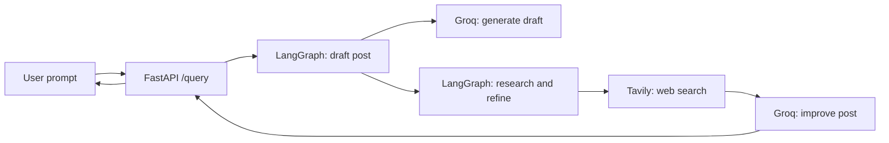

# Neural — AI Facebook Post Studio

Turn a rough idea into a polished Facebook post. **Neural** uses a LangGraph workflow to draft, research, and refine posts, with a responsive glass-inspired web interface for writing and copying the result.

> This project generates post copy only. Review generated content and any factual claims before publishing.

## Features

- Drafts friendly, concise Facebook posts from a short prompt.
- Improves each draft using a focused web search and relevant results.
- Preserves the user's intent while refining the hook, clarity, and flow.
- Displays generated paragraphs and Markdown bold text cleanly, with one-click copy.
- Responsive dark interface with an animated background and reduced-motion support.
- FastAPI endpoints and optional LangSmith tracing.

## How it works



The workflow always performs a Tavily search before generating the improved post. Search results are used as reference material; they are not instructions.

## Requirements

- Python 3.10 or later
- API keys for [Groq](https://console.groq.com/), [Tavily](https://app.tavily.com/), and [LangSmith](https://smith.langchain.com/)
- Internet access for the model APIs, web search, LangSmith tracing (when enabled), and the remotely hosted background artwork

The frontend is plain HTML, CSS, and JavaScript. It does not require Node.js, npm, a bundler, or a frontend build step.

## Setup

Run these commands from the project root. In PowerShell:

```powershell
py -m venv .venv
.\.venv\Scripts\Activate.ps1
python -m pip install -r requirements.txt
Copy-Item .env-example .env
```

Open `.env` and replace the placeholder values:

```dotenv
GROQ_API_KEY=your_groq_api_key
GROQ_MODEL_NAME=openai/gpt-oss-120b
TAVILY_API_KEY=your_tavily_api_key
LANGSMITH_API_KEY=your_langsmith_api_key
LANGSMITH_TRACING=true
LANGSMITH_PROJECT=Facebook Post Generator
```

`GROQ_MODEL_NAME` can be changed to a model available to your Groq account. The settings loader requires all four API-key/model values. LangSmith tracing defaults to `true`; set `LANGSMITH_TRACING=false` to disable tracing. `LANGSMITH_API_KEY` must still be present because it is required by the current settings schema.

**Keep `.env` private.** Never publish real API keys or commit your populated `.env` file.

## Run locally

### Option A: Serve the frontend and API together

Start FastAPI from the project root:

```powershell
uvicorn app.main:app --reload --host 127.0.0.1 --port 8000
```

Then open **http://127.0.0.1:8000/**. The same page is also available at `/frontend/`.

### Option B: Run the frontend and API on separate ports

Start the backend in one terminal:

```powershell
uvicorn app.main:app --reload --host 127.0.0.1 --port 8000
```

Start the static frontend in a second terminal:

```powershell
python -m http.server 5500 --bind 127.0.0.1 --directory frontend
```

Open **http://127.0.0.1:5500/**. The frontend sends requests to `http://127.0.0.1:8000/query`; FastAPI allows the frontend origins `http://127.0.0.1:5500` and `http://localhost:5500`.

If the frontend's host or port changes, update the allowed origins in `app/main.py` and the API URL in `frontend/index.html` to match.

## API

### `POST /query`

Generates an improved Facebook post.

**Request**

```json
{
  "query": "Announce our new neighborhood coffee shop opening this Saturday"
}
```

`query` must contain between 2 and 250 characters.

**Response**

```json
{
  "query": "Announce our new neighborhood coffee shop opening this Saturday",
  "improved_post": "Something wonderful is brewing in the neighborhood..."
}
```

Example using `curl`:

```bash
curl -X POST "http://127.0.0.1:8000/query" \
  -H "Content-Type: application/json" \
  -d "{\"query\":\"Announce our new neighborhood coffee shop opening this Saturday\"}"
```

### Other endpoints

| Method | Path | Purpose |
| --- | --- | --- |
| `GET` | `/` | Serves the frontend |
| `GET` | `/frontend/` | Serves the frontend |
| `GET` | `/health` | Returns a basic health response |
| `GET` | `/docs` | Interactive OpenAPI documentation |
| `POST` | `/query` | Generates an improved Facebook post |

## Project structure

```text
.
├── app/
│   ├── core/
│   │   └── config.py             # Environment-based settings
│   ├── graph/
│   │   ├── nodes/
│   │   │   ├── generate_post.py  # Initial Groq draft
│   │   │   └── improved_post.py  # Tavily research and final edit
│   │   ├── tools/
│   │   │   └── web_search.py     # Tavily search configuration
│   │   ├── state.py              # LangGraph state
│   │   └── workflow.py           # Graph definition
│   ├── schemas/
│   │   └── model_schema.py       # API request and response schemas
│   └── main.py                   # FastAPI application
├── frontend/
│   └── index.html                # Self-contained frontend
├── .env-example                  # Environment variable template
└── requirements.txt              # Python dependencies
```

## Troubleshooting

- **Settings validation error on startup:** Confirm `.env` exists in the project root and contains every required setting. Replace all placeholder API keys.
- **Frontend cannot reach the backend:** Start FastAPI on port `8000`. If using separate ports, open the frontend at port `5500` and keep its URL and the CORS origins aligned.
- **Model or search errors:** Verify that the Groq and Tavily keys are valid and that the selected Groq model is available to your account.
- **No background animation:** The artwork is hosted remotely; check network access. The interface honors the operating system's reduced-motion preference by pausing animation.
